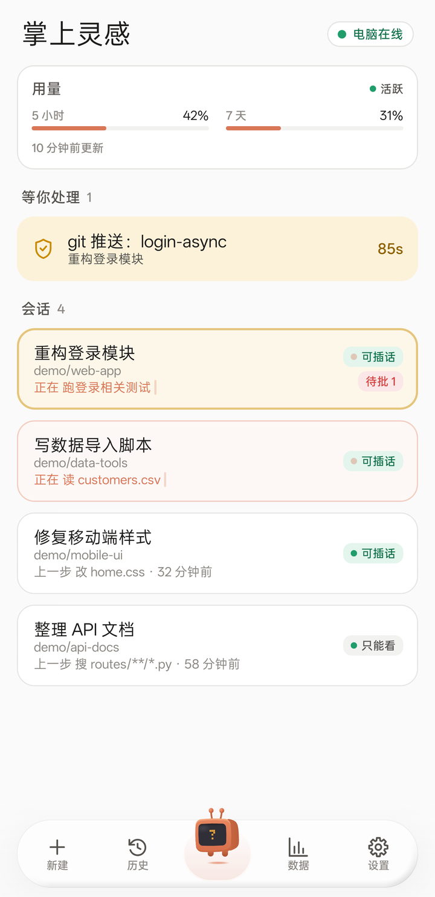
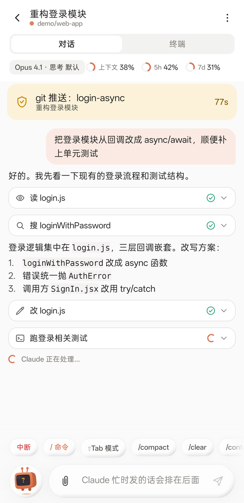
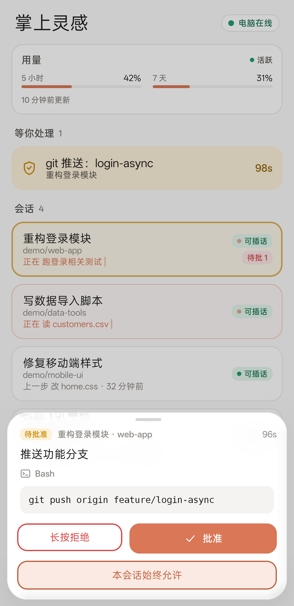
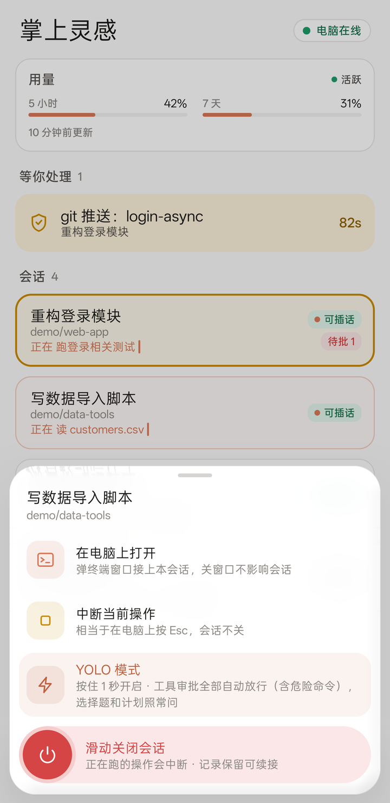
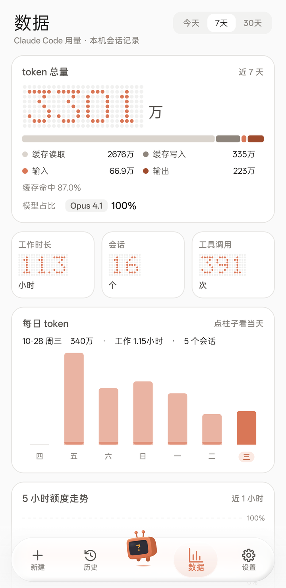
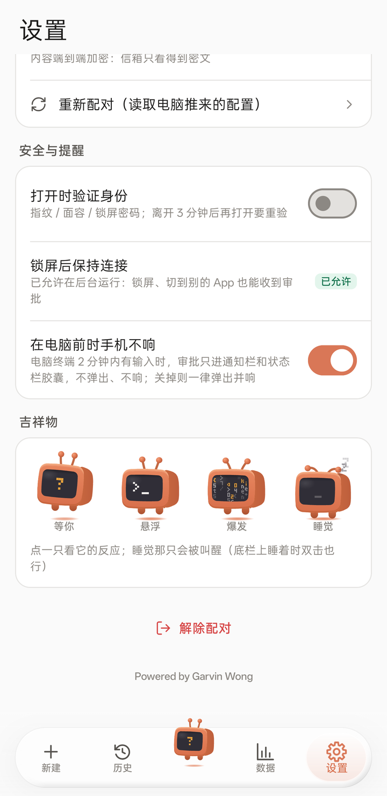

# Claude Inspire

> Unofficial project. Not affiliated with or endorsed by Anthropic. Claude and Claude Code are trademarks of Anthropic.

[中文](README.md)

Take over the Claude Code sessions running on your computer from an Android phone: watch progress, chime in, approve tool requests, resume old sessions — while the desktop terminal stays live at the same time. Step away from your desk without leaving Claude stuck on a "may I continue?" prompt.

<p align="center">
  
</p>
<p align="center">
  
</p>
<p align="center"><sub>Home · Conversation · Approval · Session actions · Stats · Settings (demo data)</sub></p>

## Features

- **Session overview** — every Claude Code session on your machine on one screen, sorted by recent activity. Running sessions get a soft shimmer and a "now doing…" line.
- **Chime in** — send messages, photos and files to a session from the phone; they show up in the desktop terminal too. If you left an unsent draft in the desktop prompt, the phone tells you and can clear it before sending.
- **Approvals** — permission requests, multiple-choice questions and plan reviews slide up from the bottom, reachable with one thumb. New ones vibrate and ring; when the app is in the background they arrive as system notifications (approve or "always allow this session" right from the notification). Dangerous commands (force push, `rm -rf`, `sudo`…) require a long press to approve; rejecting always requires a long press.
- **Terminal view** — the session's real terminal screen, with a key pad for arrows, Enter and Esc.
- **Long-press a session** — open it in a terminal window on the computer, interrupt the current step, keep it alive in the background, YOLO mode (auto-approve tool requests; questions and plans still ask you), or slide to close it.
- **Resume & new** — resume or fork past sessions into a background session; start new ones with directory, model and effort.
- **Usage** — 5-hour / 7-day quota bars; long-press the card to refresh (runs one headless Claude Code call to read live usage).
- **Stats** — daily tokens, working hours, top tools, model mix.

## How it works

```
 Android app ──(LAN / Tailscale, end-to-end encrypted)──▶ LAN mailbox ─┐
                                                                       │  computer (Linux / WSL / macOS)
                          palm-hub (session hub, 127.0.0.1) ◀──────────┘
                            │                     │
          palm-host (pty wrapper around claude)   Agents Island bridge (session state & approval hooks)
```

- **palm-host** — `claude` starts through it; it wraps Claude Code in a pseudo-terminal so the phone and the desktop terminal can both type and both see output.
- **palm-hub** — collects sessions, approvals and usage, and runs a small built-in mailbox on your LAN. Every message between phone and hub is end-to-end encrypted with a key generated at pairing time; the mailbox only ever sees ciphertext.
- **Session list and approvals** come from the bridge and hooks of [Agents Island](https://github.com/garvinwong/agents-island) (same author, MIT). Only the bridge and hooks are needed, not its desktop UI.

## Requirements

- Computer: Linux, Windows WSL2 or macOS; Python 3.10+; a signed-in [Claude Code](https://docs.anthropic.com/en/docs/claude-code).
- Agents Island bridge and Claude Code hooks installed and running (see its README).
- Phone: Android 10 or later. **The app's interface is currently Chinese only.**
- To build the app: JDK 17, Android SDK 35.

## Install

1. **Install the Agents Island bridge and hooks** (only the bridge and hooks, not the desktop UI)
   ```bash
   git clone https://github.com/garvinwong/agents-island.git ~/agents-island
   cd ~/agents-island
   python3 scripts/install_hooks.py --permission-request   # route approvals and permission prompts through the bridge
   bash launch/start_bridge.sh                              # start the bridge (127.0.0.1:5599)
   ```

2. **Get the code and dependencies**
   ```bash
   git clone https://github.com/garvinwong/claude-inspire.git ~/claude-inspire
   pip install pyte qrcode
   ```

3. **Start `claude` through the host** — add this line to the end of `~/.bashrc`, then open a new terminal:
   ```bash
   source ~/claude-inspire/host/palm.sh
   ```
   Only interactive launches are wrapped; `claude -p` and friends are untouched. Bypass once with `PALM_HOST=0 claude`.

4. **Install the hub** (systemd user service)
   ```bash
   bash ~/claude-inspire/systemd/install.sh
   loginctl enable-linger $USER   # optional: keep running without a login session
   ```
   Without systemd (e.g. macOS) just run `python3 ~/claude-inspire/hub/palm_hub.py`.

5. **Build and install the app**
   ```bash
   cd ~/claude-inspire/android
   ./gradlew assembleRelease
   adb install -r app/build/outputs/apk/release/app-release.apk
   ```
   The build is signed with the debug key — fine for your own phone.

6. **Pair**
   ```bash
   palm pair --qr          # scan the QR code with the phone camera, then tap "confirm" in the app
   systemctl --user restart palm-hub
   ```
   If the computer has several addresses, pick the one the phone can reach: `palm pair --qr --host 192.168.1.20`.

7. **Away from home** — install [Tailscale](https://tailscale.com/) on both computer and phone (same account) and pair with the computer's Tailscale address (100.x.x.x).

8. **Stay connected** — after pairing, the app asks to "run in the background"; allow it, otherwise some phones cut the connection when the screen is locked and approvals won't arrive. Settings → "Stay connected when locked" shows the current state.

### WSL users

WSL2 uses NAT by default, so the phone cannot reach addresses inside WSL. Either:
- set `networkingMode=mirrored` under `[wsl2]` in `%UserProfile%\.wslconfig`, then `wsl --shutdown`; or
- install Tailscale inside WSL and pair with its address.

## Commands

| Command | What it does |
|---|---|
| `palm` / `palm ls` | List sessions running through the host |
| `palm attach <host-id>` | Attach this terminal to a background session (closing the window only detaches) |
| `palm pair [--qr] [--host ADDR] [--rotate]` | Pair a phone; `--rotate` issues new tokens and key |
| `palm doctor` | Health check: host, hub, bridge, pairing |

Environment variables: `PALM_LAN_BIND` / `PALM_LAN_PORT` (mailbox listen address, default `0.0.0.0:5613`), `PALM_BRIDGE_URL` (bridge, default `http://127.0.0.1:5599`), `PALM_TERMINAL` (terminal command for "open on computer", e.g. `gnome-terminal -- bash -lc {cmd}`), `PALM_INBOX_DIR` (where files sent from the phone are stored).

## Security

- Pairing tokens and the key are generated locally and kept in `~/.palm/` (mode 600). The mailbox stores only token hashes.
- All messages and attachments between phone and computer are end-to-end encrypted (AES-GCM with replay-protected sequence numbers). The mailbox speaks plain HTTP but only sees ciphertext; someone on your LAN who captures a token can neither read nor forge messages.
- Use it on trusted networks or over Tailscale. `palm pair --rotate` revokes old phones at any time.
- The phone cannot start sessions in `bypassPermissions` mode. YOLO mode applies only to the session you pick and can be turned off any time.
- "Refresh usage" runs only when you tap it, at most once per 60 seconds. **Do not turn it into a scheduled job** — automated polling of subscription CLIs may get an account restricted.

## License

[PolyForm Noncommercial 1.0.0](LICENSE.md): free for personal use, study, research and non-profit organizations. **Any commercial use (including use inside a company, redistribution, or bundling into a commercial product) requires a separate license from the author** — contact via [GitHub](https://github.com/garvinwong).

Third-party components: see [THIRD_PARTY.md](THIRD_PARTY.md).

---

Powered by [Garvin Wong](https://github.com/garvinwong)
